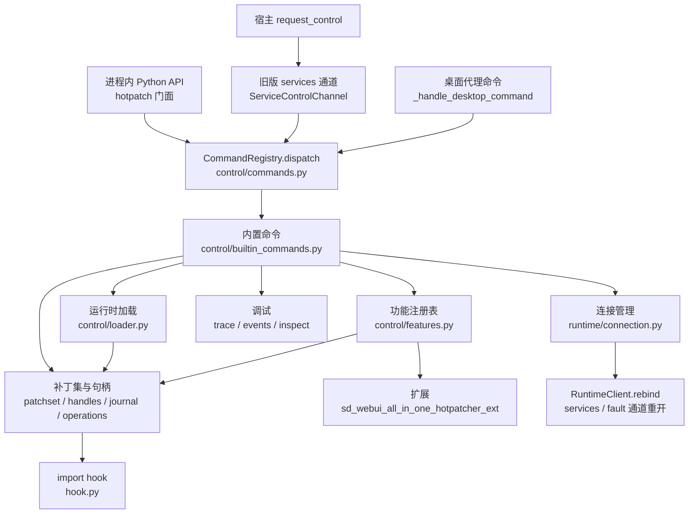

# Hotpatcher 控制平面

Hotpatcher 控制平面是 patcher 热补丁框架（`sd_webui_all_in_one/patcher/`）之上的一层统一控制能力：可撤销的补丁句柄与补丁集、更多实时补丁操作、运行时加载 / 卸载补丁模块、可扩展的功能注册表、调试工具，以及补丁进程与宿主两端可在线修改的连接参数。所有能力通过同一个命令注册表暴露给进程内 Python API、旧版 TCP JSONL services 通道和桌面 HTTP 代理三种传输。

本文描述已经实现的设计，面向维护 patcher 核心、`base_manager/hotpatcher_manager/` 宿主和 Hotpatcher 管理器 GUI 的开发者。patcher 自身的使用说明见 [Patcher 使用文档](https://github.com/licyk/sd-webui-all-in-one/blob/main/sd_webui_all_in_one/patcher/README.md)。

!!! note "来源"
    本文由实现前的规划文档改写而来，只保留与最终实现一致的内容。原始规划（包括参考项目对照和各阶段计划）保存在 git 历史的提交 `bbaab617` 中，文件名为 `HOTPATCH_CONTROL_PLAN.md`。

## 目标与约束

控制平面要解决四件事：

1. 提供更丰富的补丁操作，并且每个操作都可以撤销。
2. 提供调试能力：补丁结果记录、严格模式、跟踪输出、事件日志和诊断命令。
3. 支持在运行时加载、重新加载、修改和卸载补丁模块。
4. 支持在线修改运行时连接参数，覆盖补丁进程连接的目标（地址、端口、token、超时、重连）和宿主 `HotpatcherRuntimeHost` 自身的监听地址、端口与 token（决策 D7）。

实现时遵守的约束：

- 不引入新依赖，只使用标准库和现有基础设施。
- patcher 核心保持独立：`sd_webui_all_in_one_hotpatcher` 不导入 `sd_webui_all_in_one`，通过 `PYTHONPATH` 注入产品虚拟环境。
- 语法兼容 Python 3.10，CI 覆盖 3.10 到 3.15。
- 核心代码中不使用 `global` 语句（由 `patcher/tests/core/test_hotpatcher_state.py` 检查），进程级状态全部放在 `HotpatcherState` 上。
- 向后兼容：现有公开 API、环境变量、线上消息（`services.*`、桌面 `config.apply`、旧版 JSONL）以及 `get_default_config()` / `get_catalog()` 的已有内容保持不变。

## 解决的问题

| 编号 | 实现前的限制 | 现在的处理 |
| --- | --- | --- |
| L1 | 补丁是匿名元组，无法逐个列出、卸载或替换。 | 每个注册返回 `PatchHandle`，ID 形如 `patch_N`，保存在 `state.patch_handles`。 |
| L2 | 没有任何撤销手段，services v1 明确“不卸载”。 | `PatchJournal` 记录逆操作，`PatchSet` 整体按 LIFO 撤销；`apply_config` 默认仍保持 v1 语义，撤销需要显式开启 reconcile。 |
| L3 | 补丁必须在目标模块首次导入前注册。 | `apply_if_loaded=True` 把执行后阶段追溯应用到已导入模块；实时操作直接修改已加载对象。 |
| L4 | 非 `SourceFileLoader` 模块完全不会被打补丁。 | `PostExecLoader` 包装其他 loader，执行后阶段照常运行，源码 / AST / 字节码阶段记录为 `skipped:unsupported_loader`。 |
| L5 | 补丁失败或源码补丁没有匹配时完全静默。 | 每次执行记录 `PatchOutcome`；提供严格模式、跟踪、事件日志和 `explain` / `verify`。 |
| L6 | 无法在运行时从文件或模块加载、重新加载、卸载补丁。 | `control/loader.py` 提供事务式加载、带回滚的重新加载、原地更新和卸载报告。 |
| L7 | 功能目录在 `services.py` 中硬编码五处，扩展不可插拔。 | `FeatureSpec` / `FeatureRegistry`，默认配置、schema、目录、应用和告警都从注册表派生。 |
| L8 | 三套临时分发器，没有共享命令模型、能力发现和版本。 | `CommandRegistry.dispatch` 是唯一分发点，`hotpatch.capabilities` 报告 `CONTROL_VERSION`。 |
| L9 | 旧版连接参数在启动时冻结，没有重连，启动路径无法设置 host / token 并会丢弃超时设置。 | `ConnectionManager` 先建后拆地切换连接，可选自动重连；启动环境支持 `host` / `token` 并保留用户超时变量。 |
| L10 | 补丁计划变化后，finder 缓存仍可能返回旧的包装 spec。 | 每次计划变化都调用 `HookedMetaPathFinder.invalidate(fullname)`。 |
| L11 | `spec_from_file_location` 包装器总是使用默认状态。 | 包装器解析拥有当前 finder 的状态对象。 |

## 架构

### 分层



`control/` 子包按需导入：`import sd_webui_all_in_one_hotpatcher` 和 `install_import_hook()` 都不会加载它，只有注册补丁、列出句柄、访问 `hotpatch` 门面或首次使用功能注册表时才会导入。`services` 在导入时依赖 `control.features`（只是数据和轻量函数），但不会加载任何 `sd_webui_all_in_one_hotpatcher_ext` 模块，这个不变量由 `tests/services/test_services_import_invariant.py` 保证。

### `control/` 模块

| 模块 | 职责 |
| --- | --- |
| `journal.py` | `NOTSET`、`JournalEntry`、`PatchJournal`：单一 LIFO 撤销列表，逐条隔离失败，`undo()` 幂等；类属性从原始 `__dict__` 读取以保留描述符。 |
| `targets.py` | `resolve_target`、`split_target`、`parse_target`：解析 `"pkg.mod:Obj.attr"` 和点分写法，区分模块缺失与属性缺失。 |
| `handles.py` | `PatchHandle`、`PatchStatus`、`PatchOutcome`、`PatchOutcomeKind` 与基于 `state.patch_id_counter` 的 ID 分配。 |
| `patchset.py` | `PatchSet`（加载与卸载的单位）、`PatchContext`（补丁作者使用的对象）、`current_patch_context()` 上下文变量。 |
| `operations.py` | 全部实时操作的唯一实现，包括蹦床（`Trampoline`）和 `rebind_references`。 |
| `loader.py` | `load_patch` / `unload_patch` / `reload_patch` / `update_patch`、`control` 配置区段、`PatchFileWatcher`、`check_remote_load_allowed`。 |
| `features.py` | `FeatureSpec`、`FeatureRegistry`、`BUILTIN_FEATURES`、`enable_feature` / `disable_feature` / `update_feature`。 |
| `trace.py` | `HotpatchTracer`：TagTracer 风格的分层跟踪，自动脱敏。 |
| `events.py` | `PatchEventLog`：带游标的事件环形缓冲区与可选事件转发。 |
| `inspect.py` | `explain`、`render_patched_source`、`verify_source_patches`、`status_snapshot`。 |
| `commands.py` | `CommandSpec`、`PayloadField`、`CommandContext`、`CommandRegistry`、envelope 与错误码。 |
| `builtin_commands.py` | 内置命令的处理函数和信任边界检查。 |
| `controller.py` | `HotpatchController` 门面、`get_controller()` 和操作锁。 |

运行时一侧新增 `runtime/connection.py`（`RuntimeConnectionSettings`、`ConnectionManager`、`get_connection_manager`），宿主一侧新增 `base_manager/hotpatcher_manager/host_control.py`（`RuntimeControlMixin`）和 GUI 的 `hotpatcher_manager_gui/runtime_control.py`。

### 状态字段

所有控制平面状态都是 `HotpatcherState` 的字段，惰性创建：

| 字段 | 内容 |
| --- | --- |
| `control_lock` | 控制平面注册表锁（`RLock`）。 |
| `patch_id_counter` | 句柄与补丁集共用的 ID 计数器。 |
| `patch_sets` / `patch_handles` | 已注册补丁集和句柄，键为 ID。 |
| `feature_registry` | 功能注册表，首次通过 `get_feature_registry()` 访问时创建。 |
| `strict_mode` | 严格模式，创建状态对象时读取 `SD_WEBUI_ALL_IN_ONE_HOTPATCHER_STRICT`。 |
| `loaded_patches` / `loading_patches` | 运行时加载的补丁（键为补丁名称）和正在操作的名称。 |
| `rebind_skip_modules` | `rebind_references` 扫描时跳过的模块。 |
| `patch_file_watcher` | 补丁文件监视器。 |
| `tracer` / `event_log` | 跟踪输出器和事件环形缓冲区。 |
| `controller` | `HotpatchController`。 |
| `connection_manager` / `fault_channel` | 旧版连接管理器和最近安装的 fault 通道。 |

### 锁约定

`control_lock` 只保护内存注册表的读写。持有它时绝不执行 `importlib` 调用、用户补丁函数、`setup` 回调或 socket / HTTP I/O，调用方在锁内计算、在锁外执行。原因是主线程可能持有模块导入锁并读取补丁计划，而控制线程如果持有 `control_lock` 再去导入模块就会死锁。

固定的锁顺序：

- `PatchSet._lock` → `control_lock`；
- `Monkey._lock` → `control_lock`（分配和登记句柄 ID），反方向不允许；
- `PatchEventLog` 和 `CommandRegistry` 使用内部叶子锁，记录事件时从不获取 `control_lock`；
- `Trampoline` 和 `ConnectionManager` 的内部锁也是叶子锁，持有时不调用用户代码或做 I/O。

功能与补丁集的修改操作另有操作锁（`HotpatchController.operation_lock`），键为 `feature:<key>`、`set:<name>` 或 `module:<name>`。操作锁会包住用户代码，所以总是以 `OPERATION_LOCK_TIMEOUT`（0.2 秒）尝试获取，超时返回 `busy`；即使导入中的代码反向调用控制命令，也只会得到 `busy` 而不会死锁。

import hook 的递归保护 `LoadingSkipper`（`hook.py` 与 `stack_shadow.py` 各一份）改为线程本地存储，控制线程并发调用 `find_spec` 时不会因为另一个线程正在导入同名模块而拿到未包装的 spec。

## 补丁句柄与卸载语义

### 句柄、状态与结果

每个补丁注册或实时修改对应一个 `PatchHandle`，主要字段为 `id`、`kind`、`target`、`owner`（所属补丁集 ID）、`stage`、`status`、最近 20 条 `outcomes`（`MAX_HANDLE_OUTCOMES`）和不受上限影响的 `outcome_counts`。补丁集 ID 形如 `set_N`，与句柄共用计数器。

`PatchStatus` 取值：

| 状态 | 含义 |
| --- | --- |
| `registered` | 已登记但尚未生效，例如目标模块尚未导入的 import 阶段补丁。 |
| `applied` | 已生效。 |
| `reverted` | 已完全撤销。 |
| `deregistered` | 生效前已从补丁计划中移除。 |
| `failed` | 应用或撤销失败。 |
| `requires_restart` | 已从计划中移除，但已执行的效果只能通过重启进程消除。 |

每次执行补丁函数记录一个 `PatchOutcome`，`kind` 为 `applied`、`noop`、`failed` 或 `skipped`：

- `noop`：源码补丁返回相同文本、函数补丁返回 None、AST 补丁返回同一棵未修改的树。AST 的 `ast.dump` 比较开销较大，只在 `SD_WEBUI_ALL_IN_ONE_HOTPATCHER_DEBUG=1`、严格模式、启用 `patch` 跟踪标签或 `inspect.source` / `verify` 预演时执行。
- `failed`：带异常类型、信息（最多 1000 字符）和有界 traceback（最多 8000 字符）。
- `skipped`：带原因，例如 `function_missing`、`unsupported_loader`、`condition_false`、`already_imported`。

### 补丁集

`PatchSet` 拥有一个 `PatchJournal` 和一组句柄，是加载与卸载的基本单位：

```python
from sd_webui_all_in_one_hotpatcher.control import PatchSet, register_patch_set

patch_set = register_patch_set(PatchSet("my-fix"))
with patch_set as ctx:  # ctx 是 PatchContext
    ctx.set_attr("pkg.mod:FLAG", True)

report = patch_set.close()  # 按 LIFO 撤销, 返回 PatchSetReport
```

- 事务模式（默认）下，`with` 块或 `run()` 回调抛出异常会撤销全部修改，状态固定为 `failed`，原异常继续抛出。
- `close()` / `unload()` 幂等，关闭后句柄从 `state.patch_handles` 移除，但仍可通过 `patch_set.handles` 和报告查看。
- 关闭后再添加修改会抛出 `PatchSetClosedError`；关闭后调用 `add_disposer` 会立即执行该清理函数。
- 补丁集处于激活状态（`with patch_set:`、`patch_set.run(...)`、`context.activate()`）时，`current_patch_context()` 返回它的上下文。

### import 阶段补丁的句柄

`Monkey` 的八个公开列表保持原有元组结构（扩展代码会直接解包），句柄 ID 保存在逐阶段对齐的平行列表中。移除时按身份（`is`）查找条目并同时删除两边的同一位置；绕过 `patch_*` 直接追加到公开列表的条目会在首次列出计划时惰性生成句柄。

- 所有 `Monkey.patch_*`、`inject_import`、`prohibit_output`，以及 `register_hook`、`register_customize_hook`、`MonkeyZoo.alias_if_not_exists` 都返回 `PatchHandle`。
- 所有注册都接受 `condition=`，在应用时求值，返回假值时记录 `skipped:condition_false`。
- `patch_module` 和 `patch_premodule` 接受 `revert=`，提供后卸载状态为 `reverted`。
- 归属：补丁集激活期间的 `patch_*` 注册（包括经由普通 `monkey_zoo(...)` / `register_hook(...)` 的注册）自动归属该补丁集；补丁函数在导入时执行时也会重新激活所属补丁集。因此未修改的扩展 `apply_from_config` 代码也能被 `features.disable` 撤销。
- 函数、import 注入和输出抑制对模块命名空间的写入由框架记录到日志（有主条目写入补丁集日志，无主条目写入 `Monkey` 自己的日志），撤销时检查身份，写入已被其他对象覆盖时报告 `requires_restart`。
- `Monkey.remove(handle)` 移除条目并撤销框架写入；`MonkeyZoo.remove(handle)` 在全部计划和别名中查找。
- `MonkeyZoo.discard(name)` 和 `MonkeyZoo.clear()` 只从计划中移除，不撤销已经写入模块的修改。
- 每次计划变化都会使 finder 中该模块的 spec 缓存失效（L10）。
- 追溯应用：`monkey_zoo(name, apply_if_loaded=True)` 或 `ctx.module(name, apply_if_loaded=True)` 在退出时把新增条目的执行后阶段（函数、模块、import 注入、输出抑制）应用到 `sys.modules` 中已有的模块。
- `PostExecLoader` 包装扩展模块、无源码 `.pyc`、zipimport 等 loader（L4），`create_module` / `exec_module` 委托给原 loader，其他属性透传。
- 对打过补丁的模块执行 `importlib.reload` 会重新应用当前补丁计划。

### 卸载语义

卸载补丁集或移除单个句柄时，每个句柄的最终状态按下表确定：

| 阶段或类型 | 目标尚未导入 | 目标已经导入 |
| --- | --- | --- |
| `patch_sources` / `patch_ast` / `patch_bytecode` | `deregistered` | `requires_restart`：已编译的代码无法还原，只影响之后的导入和 reload。 |
| `patch_premodule` / `patch_module` | `deregistered` | 提供 `revert=` 时为 `reverted`；否则若补丁函数每次执行都通过 `ctx.*` 登记了实时操作且没有抛出异常，这些操作被撤销并报告 `reverted`；其余为 `requires_restart`。 |
| `inject_import` | `deregistered` | `reverted`（框架记录的写入）。 |
| `patch_function` | `deregistered` | `reverted`；复制到其他模块的引用只有在使用蹦床或 `rebind_references` 时才会跟随。 |
| `prohibit_output` | `deregistered` | `reverted`。 |
| `alias_if_not_exists` | `deregistered` | 被别名的模块已在 `sys.modules` 中时为 `requires_restart`。 |
| 实时操作 | 不适用 | `reverted`；`reload_module` 总是 `requires_restart`。 |
| 运行时功能（浏览器、错误、日志） | 不适用 | 使用已有卸载路径：浏览器切换到 `passthrough`、`uninstall_error_capture`、`uninstall_log_capture`。仍然生效的功能报告 `requires_restart`。 |

同一句柄有多个撤销结果时取最严重的状态，优先级为 `failed` > `requires_restart` > `reverted` > `deregistered`。

!!! warning "启发式规则的边界"
    模块级补丁的 `reverted` 判定只覆盖通过 `ctx.*` 登记的修改。补丁函数直接执行的 `setattr` 等修改框架无法察觉，同时存在这类修改时应提供 `revert=`，它优先于启发式规则。

## 实时补丁操作

`PatchContext` 的每个方法都返回 `PatchHandle` 并把逆操作写入补丁集日志：

| 方法 | 作用与撤销 |
| --- | --- |
| `set_attr(target, name, value, *, raising=True, rebind_references=False, rebind_limit=...)` | 设置属性，也接受 `set_attr("pkg.mod:Obj.name", value)`；类属性按原始 `__dict__` 恢复。 |
| `del_attr(target, name=..., *, raising=True)` | 删除属性，撤销时恢复。 |
| `set_item(mapping, key, value)` / `del_item(mapping, key, *, raising=True)` | 修改映射条目。 |
| `set_env(name, value, *, prepend=None)` / `del_env(name, *, raising=True)` | 修改环境变量，语义同 pytest `setenv`。 |
| `syspath_prepend(path)` | 插入 `sys.path` 首位，撤销时按值移除。 |
| `wrap(target, factory, *, trampoline=False, rebind_references=False, rebind_limit=...)` | `factory(original)` 返回替换对象；返回 None 记录 `noop`。 |
| `patch_method(target, factory, *, trampoline=False)` | 包装类成员并保留 `staticmethod` / `classmethod` / `property` 描述符，撤销时恢复原描述符。 |
| `set_class_attr(target, name, value, *, raising=True)` | 设置类属性并保留描述符语义。 |
| `reload_module(name)` | 在当前补丁计划下执行 `importlib.reload`，不可撤销，句柄状态为 `requires_restart`。 |
| `add_disposer(disposer, label=None)` | 登记任意清理函数，随日志按 LIFO 执行。 |
| `module(name, *, apply_if_loaded=False)` | 上下文管理器，返回目标模块的 `Monkey`，块内注册归属本补丁集。 |

失败语义：

- 基础操作（属性、条目、环境变量、`sys.path`）的任何失败都会把句柄标记为 `failed` 并抛出异常。
- `wrap`、`patch_method`、`set_class_attr`、`reload_module` 的目标解析失败（模块不存在、属性不存在）只把句柄标记为 `failed`（原因 `target_unresolved`）并记录警告，严格模式下照常抛出。工厂函数自身的异常总是抛出。
- 操作中途失败时，本句柄已写入的日志条目立即撤销，不会留下部分生效的修改。

蹦床与引用复制：

- `trampoline=True` 在目标位置安装一个稳定的转发函数（带 `__sd_webui_aio_trampoline__` 属性），卸载只把转发目标换回原函数，转发函数本身永久保留。同一位置的多层蹦床包装可以按任意顺序卸载，也支持异步函数。
- 安装蹦床之后通过 `from x import f` 复制出去的引用会跟随包装与卸载；安装之前复制的引用指向原函数对象，只能通过 `rebind_references=True` 改为指向新对象。
- `rebind_references` 扫描 `sys.modules` 中各模块的命名空间，按身份替换对原对象的引用，每个位置单独写日志，最多 `MAX_REBIND_REFERENCES`（1000）处，超出时结果 `detail["truncated"]` 为 True。hotpatcher 自身模块、文件加载的私有补丁模块和 `state.rebind_skip_modules` 中的模块不参与扫描，避免包装函数通过模块全局变量调用到自己。

## 运行时加载补丁

### 补丁模块

补丁模块是定义了以下函数的 Python 模块或文件：

```python
def setup(ctx: PatchContext) -> None: ...                 # 必需
def teardown(ctx: PatchContext) -> None: ...              # 可选, 卸载时在撤销日志之前调用
def update(ctx: PatchContext, config: dict) -> bool: ...  # 可选, 原地修改参数
```

可运行的完整示例见 [`examples/runtime_patch_load.py`](https://github.com/licyk/sd-webui-all-in-one/blob/main/sd_webui_all_in_one/patcher/examples/runtime_patch_load.py) 和它加载的 [`examples/greeting_patch.py`](https://github.com/licyk/sd-webui-all-in-one/blob/main/sd_webui_all_in_one/patcher/examples/greeting_patch.py)。

### 加载、卸载、重新加载与更新

`control.loader` 的公开函数都返回 JSON 安全的报告字典，不抛出异常：

- `load_patch(source, *, name=None, config=None, state=None, origin="api")`：`source` 为点分模块名时按常规方式导入；以 `.py` 结尾或指向已存在路径时按文件加载，模块名为私有的 `sd_webui_all_in_one_hotpatcher_dynamic.<set_id>`，不出现在用户可见的模块名中，卸载后也会从 `sys.modules` 移除。文件加载不使用字节码缓存。模块导入与 `setup` 都在新建的事务补丁集激活时执行，任一步失败都会撤销全部修改，报告状态为 `failed`。
- `unload_patch(key)`：调用 `teardown`，关闭补丁集，移除私有模块和 rebind 跳过登记。报告的 `handles` 为逐句柄状态，`status` 取其中最严重者（没有句柄时为 `reverted`，有错误时为 `failed`）。
- `reload_patch(key, *, config=None)`：先卸载旧补丁集再执行新代码。新代码导入或 `setup` 失败时，用旧模块对象在新补丁集中重新执行旧 `setup`（点分模块先恢复其 `__dict__` 快照），状态为 `rolled_back` 并附带错误；回滚也失败时状态为 `failed` 并同时包含两个错误。
- `update_patch(key, config)`：模块定义了 `update` 且返回真值时原地修改（`mode` 为 `in_place`，状态 `updated`），否则以新配置重新加载（`mode` 为 `reload`）。`update` 抛出异常时补丁集保持不变，状态为 `failed`。

补丁名称是跨重新加载保持不变的键，补丁集 ID 每次（重新）加载都会变化，因为已关闭的补丁集不能重新打开。`key` 参数同时接受补丁集 ID 和名称，ID 优先。同名补丁的并发操作通过 `state.loading_patches` 标记拒绝（`busy`），不会在执行用户代码时持有互斥锁。

### 配置声明的补丁集

新的 `control` 配置区段由内置功能 `control` 应用，在全部扩展之后执行：

```json
{
  "control": {
    "allow_remote_load": false,
    "patch_sets": [
      {"source": "my_patches.fix_foo", "name": "fix-foo", "config": {}, "enabled": true}
    ],
    "watch": {"enabled": false, "interval": 1.0},
    "forward_events": false
  }
}
```

- 条目逐个处理，单个条目出错只记录到 `errors`，不影响其他条目；重复名称的条目被忽略。
- 重复应用是幂等的：来源改变时重新加载，文件哈希改变时 `reload_patch`，只有配置改变时 `update_patch`。
- 不再列出或 `enabled: false` 的配置来源补丁默认保留并产生告警；开启 reconcile 时被卸载。通过 API 加载的补丁（`origin="api"`）不受配置影响。
- 目录 schema 为此新增了 `json` 和 `float` 两种设置类型，Hotpatcher 管理器 GUI 已支持。

### 文件监视

`PatchFileWatcher` 只使用标准库轮询，默认关闭。`SD_WEBUI_ALL_IN_ONE_HOTPATCHER_WATCH=1` 或 `control.watch.enabled` 开启后，守护线程每 `interval` 秒（默认 1.0）比较已加载补丁源文件的 mtime 和大小，变化时重新计算 SHA-256；哈希不同且在 0.5 秒防抖时间内保持不变时调用 `reload_patch`。重新加载失败（含回滚）的内容会被记住，直到文件再次变化才重试。

!!! warning "点分模块的字节码缓存"
    按点分模块名加载的补丁通过 `importlib.reload` 重新执行，使用正常的 `.pyc` 缓存。同一秒内多次改写同样大小的源码可能命中过期的字节码缓存；文件路径加载不受影响。

## 功能注册表

### `FeatureSpec`

每个 services 功能由一个不可变的 `FeatureSpec` 描述：

| 字段 | 说明 |
| --- | --- |
| `key` | 目录键，例如 `extensions.uv_pip`，按 `.` 拆分得到配置路径；不能与已有键互为前缀。 |
| `title` / `description` | 目录标题与描述。 |
| `defaults` / `settings` | 默认配置和设置 schema。 |
| `apply` | `apply(ctx, section) -> bool`，可为 None 表示只有配置区段（例如 `services`）。 |
| `is_active` / `is_registered` | 状态探测，填充目录的 `active` / `registered` 字段并用于禁用告警。 |
| `revert` | 禁用时在关闭补丁集之后调用，返回 None 视为 `reverted`。 |
| `update` | `update(ctx, old_section, new_section) -> bool`，返回 False 时退回为先禁用再启用。 |
| `on_disabled` | v1 `apply_config` 在功能禁用或缺少 runtime client 时执行的处理。 |
| `enabled` | 区段是否启用的判断，默认读取 `enabled` 字段。 |
| `requires_runtime_client` / `optional` | 需要 runtime client；`optional=True` 时 `apply` 返回假值表示跳过。 |
| `disabled_warning` | 功能被禁用但仍生效时的告警文本，保持与 v1 完全一致。 |
| `order` / `config_order` | 应用顺序与默认配置中的排列顺序。 |

行为字段可以是可调用对象，也可以是 `"module:callable"` 字符串。字符串在每次调用时重新解析、不做缓存，因此内置功能的数据位于核心包内，导入 `services` 不会加载任何扩展模块，扩展仍然在 `apply_config` 安装栈隐藏器之后才首次导入。只接收区段配置或不接收参数的扩展入口通过 `ConfigCall` / `NoArgCall` 适配。

内置功能（`BUILTIN_FEATURES`，按应用顺序）：

| 键 | 顺序 | 说明 |
| --- | --- | --- |
| `services` | 0 | 只有配置区段：`apply_on_bootstrap`、`reconcile_disabled`。 |
| `core.import_hook` | 10 | 安装 import hook。 |
| `core.stack_shadow` | 15 | 安装栈隐藏器。 |
| `runtime.browser` | 20 | 浏览器打开补丁，支持原地 `update`。 |
| `runtime.errors` | 25 | 错误捕获，需要 runtime client。 |
| `runtime.logs` | 30 | 日志采集，需要 runtime client。 |
| `extensions.comfyui_auto_port` | 40 | ComfyUI 端口自动避让。 |
| `extensions.zluda` | 45 | ZLUDA 兼容。 |
| `extensions.extension_index` | 50 | 扩展索引镜像，任一子项启用即启用。 |
| `extensions.hf_endpoint_mirror` | 55 | HuggingFace 镜像。 |
| `extensions.uv_pip` | 60 | uv 替换 pip，`revert` 为 `unpatch_uv_to_subprocess`。 |
| `extensions.xformers_cutlass` | 65 | xFormers CUTLASS 兼容，可选功能。 |
| `control` | 90 | 配置声明的补丁集、文件监视和事件转发。 |

### 应用语义

- `DEFAULT_CONFIG`、`SETTING_SCHEMA`、目录、`normalize_config`、`apply_config` 和禁用告警都从注册表派生；`services` 模块级常量 `DEFAULT_CONFIG` / `SETTING_SCHEMA` 仍作为计算后的字典保留。
- 每个功能在自己的补丁集 `feature:<key>` 中应用，重复应用复用同一个补丁集（扩展自己负责去重）。
- 扩展入口导入失败或抛出异常时记录到结果的 `errors`（`code` 为异常类型名），不会中断其他功能。
- `apply_config(config, *, runtime_client=None, state=None, reconcile=None)` 默认保持 v1 语义：`enabled=false` 只表示不再注册，已生效的补丁保留并产生告警（决策 D5）。`reconcile=True` 或配置 `services.reconcile_disabled: true` 时撤销之前已应用、现在被禁用的功能，结果多出 `reconciled` 列表；显式传入的 `reconcile` 优先于配置。
- `enable_feature(key, config=None)`、`disable_feature(key)`、`update_feature(key, config)` 返回 JSON 安全报告。`disable_feature` 之后功能仍然生效（`is_registered` / `is_active`）时状态为 `requires_restart` 并附带 `disabled_warning`。
- `list_features()` 返回每个功能的应用状态、补丁集与句柄摘要。

### 新增功能或扩展

扩展代码不需要感知补丁集：`apply` 期间功能补丁集处于激活状态，普通 `monkey_zoo(...)` 注册会经由 `current_patch_context()` 自动归属到它。需要实时修改时使用 `ctx.patch_set.context` 上的操作，它们会被记录并在禁用时撤销：

```python
from sd_webui_all_in_one_hotpatcher import monkey_zoo
from sd_webui_all_in_one_hotpatcher.control.features import FeatureSpec, get_feature_registry


def apply_demo(ctx, section):
    with monkey_zoo("demo_target") as monkey:
        monkey.patch_module(lambda module: None)
    ctx.patch_set.context.set_env("DEMO_LEVEL", str(section["level"]))


get_feature_registry().register(
    FeatureSpec(
        key="thirdparty.demo",
        title="Demo",
        description="示例功能",
        defaults={"enabled": False, "level": 1},
        settings={"level": {"type": "int", "title": "Level", "description": "示例参数"}},
        apply=apply_demo,
    )
)
```

注册后该功能立即出现在 `get_default_config()`、`get_catalog()` 和 `apply_config()` 中。内置扩展的新功能应作为数据加入 `features.py` 的 `BUILTIN_FEATURES`，行为字段使用指向扩展模块的字符串引用，并同步更新 golden 快照（见下文“测试”一节）。

## 调试

| 能力 | 入口 | 说明 |
| --- | --- | --- |
| 补丁结果 | `hotpatch.patches.list` / `.get` | 状态、最近结果、计数、所属补丁集、目标和阶段。 |
| 严格模式 | `SD_WEBUI_ALL_IN_ONE_HOTPATCHER_STRICT=1`、`set_strict_mode()`、`hotpatch.debug.strict.set` | import 阶段补丁抛出的异常在记录 `failed` 结果后继续向外抛出，只影响之后执行的补丁。 |
| 跟踪 | `SD_WEBUI_ALL_IN_ONE_HOTPATCHER_TRACE`、`..._TRACE_FILE`、`hotpatch.debug.trace.get` / `.set` | 标签 `import`、`patch`、`control`、`conn`、`set`、`feature` 或 `all`，分层匹配（`patch` 包含 `patch.failed`）。默认写入 stderr，文件为追加写入。关闭时调用点只做一次属性检查。 |
| 事件日志 | `hotpatch.debug.events.read {since_cursor, limit}` | 容量 1000 的环形缓冲区。 |
| 事件转发 | 配置 `control.forward_events` | 默认关闭。 |
| 解释 | `hotpatch.inspect.explain {module}` | 回答“这个模块为什么（没有）被打补丁”。 |
| 补丁后源码 | `hotpatch.inspect.source {module, max_bytes}` | 只预演源码与 AST 补丁并 `ast.unparse`，不执行模块。 |
| 预演校验 | `hotpatch.inspect.verify {module?}` | 预演源码、AST 与字节码补丁，报告哪些补丁函数是 noop。 |
| 状态快照 | `hotpatch.status` | 版本、传输、hook、补丁集、功能、调试与连接状态，token 已脱敏。 |

严格模式的初始值在创建 `HotpatcherState` 时读取一次环境变量，默认状态在导入 `state` 模块时创建，之后修改环境变量不会生效，运行时请使用 `set_strict_mode()`。跟踪字段和事件载荷会经过 `redact_mapping`，键名包含 `token`、`secret`、`password` 等的值替换为 `***`。

事件日志：

- 每条事件有从 0 开始单调递增的游标、时间戳、类型和载荷。`read` 返回 `events`、`start_cursor`、`next_cursor`、`truncated`（`since_cursor` 早于最旧保留事件时为 True）和 `has_more`（受 `limit` 或 48 KiB 字节预算限制还有未返回的事件），结构与宿主 `read_logs` 一致。
- 事件类型（`EVENT_TYPES`）：`patch.registered`、`patch.applied`、`patch.noop`、`patch.failed`、`patch.skipped`、`patch.reverted`、`import.intercepted`、`import.skipped`、`set.loaded`、`set.unloaded`、`set.reloaded`、`set.rolled_back`、`set.updated`、`set.failed`、`set.watch_reload`、`set.watch_failed`、`feature.enabled`、`feature.disabled`、`feature.updated`、`connection.changed`、`debug.strict.changed`、`debug.trace.changed`、`debug.forwarding.changed`。
- 记录事件只在内部叶子锁内追加元组，JSON 安全化、脱敏和长度限制在读取或转发时惰性完成；单条事件上限 8 KiB。
- 开启 `control.forward_events` 后，`patch.failed`、`set.*`、`feature.*` 和 `connection.changed` 以 `hotpatch.event` 类型经运行时客户端发送，每秒最多 10 条，载荷上限 12 KiB，以保护桌面代理普通事件 240 条的准入额度。

`explain` 不导入模块也不写入 finder 缓存，`reasons` 中的 `code` 包括 `not_registered`、`alias_fallback`、`already_imported`、`imported_with_hook`、`finder_not_installed`、`finder_after_stack_shadow`、`stack_shadow_conflict`、`module_not_found`、`unsupported_loader`、`code_stages_unsupported`、`cached_spec`、`no_cached_spec`、`handle_failed`、`handle_noop`、`handle_skipped`。

诊断结果都有界：JSON 编码后低于 60 KiB（`MAX_RESULT_BYTES`）；`inspect.source` 默认最多 48 KiB 源码，最大 56 KiB，超出时设置 `truncated`。

## 统一命令 API

### Envelope 与错误码

所有入口都经过 `CommandRegistry.dispatch`，它从不抛出异常。envelope 与 services v1 一致：

```json
{"ok": true, "payload": {}}
{"ok": false, "error": {"code": "not_found", "message": "..."}}
```

`hotpatch.*` 命令的错误对象可以额外带 `details`（例如加载失败时的完整报告）；`services.*` 命令的错误对象只有 `code` 和 `message`，与 v1 字节级一致。

错误码（`ERROR_CODES`）：

| 错误码 | 含义 |
| --- | --- |
| `invalid_request` | 请求载荷不是对象（services v1）。 |
| `invalid_json` | 请求无法解码（services v1）。 |
| `unknown_request` | 未知命令（services v1；桌面传输映射为 `unknown_command`）。 |
| `request_failed` | 处理函数失败，包括导入、`setup`、回滚等失败。 |
| `invalid_payload` | 载荷校验失败或参数非法。 |
| `forbidden` | 传输策略或 token 要求不满足。 |
| `not_found` | 句柄、补丁集、补丁、功能或模块不存在。 |
| `unsupported_transport` | 当前传输不支持该命令或该载荷。 |
| `connection_failed` | 建立新连接失败或切换已回滚。 |
| `remote_load_disabled` | 远程加载开关未开启（D6）。 |
| `busy` | 同一功能、补丁集或连接上已有操作进行中。 |
| `conflict` | 前置条件冲突，例如对功能补丁集使用 `sets.unload`、重名加载或没有旧版连接。 |

### 分发顺序与传输策略

`dispatch` 依次执行：解析名称与别名 → 传输检查（`remote`、`transports` 白名单、`blocking`、`requires_token`）→ 载荷校验（`PayloadField`）→ 调用处理函数 → 桌面结果大小检查 → 生成 envelope。启用 `control` 跟踪标签时输出包含耗时的跟踪行。

三种传输：

- `inprocess`：Python API。响应后回调（`after_send`）在分发返回后立即执行。
- `legacy`：旧版 TCP JSONL services 通道（`ServiceControlChannel`），命令在通道读取线程上执行，只阻塞该通道；`after_send` 在响应写出之后执行。
- `desktop`：桌面 HTTP 代理（`_handle_desktop_command`），命令在唯一的代理工作线程上同步执行，该线程同时负责心跳和事件上传。

传输规则：

- `blocking=True` 的命令可能导入模块或执行用户代码，在桌面传输上返回 `unsupported_transport` 且不调用处理函数。`config.apply` 保持 v1 的同步语义，不受此限制（见“已知限制”）。
- `conditional_blocking=True` 的命令（`features.enable` / `.update`）只在首次解析惰性入口（需要导入扩展模块）或会加载 `control.patch_sets` 时在桌面传输上返回 `unsupported_transport`。
- `requires_token=True` 的命令在旧版传输的 token 为空时返回 `forbidden`。
- 桌面传输的成功结果 JSON 编码后超过 63 KiB（`MAX_DESKTOP_RESULT_BYTES`）时返回 `request_failed`，信息以 `result_too_large:` 开头。
- 桌面 `config.apply` 保持 v1 契约：`payload.config` 不是对象时为 `invalid_command_payload`，结果映射为 `{"applyResult": ...}`，未知命令为 `unknown_command`。

### 命令表

`CONTROL_VERSION` 为 1，与运行时协议版本 `PROTOCOL_VERSION`（1）相互独立。下表中“标记”列：M 为 `mutating`，B 为 `blocking`，CB 为 `conditional_blocking`，T 为 `requires_token`。

| 命令 | 载荷 | 标记 | 说明 |
| --- | --- | --- | --- |
| `hotpatch.capabilities` | 无 | | 能力探测。 |
| `hotpatch.status` | 无 | | 状态快照。 |
| `hotpatch.patches.list` | `owner?`、`limit?`（默认 200，最大 1000） | | 列出句柄，`{patches, count, truncated}`。 |
| `hotpatch.patches.get` | `id` | | 单个句柄详情，最多 48 KiB。 |
| `hotpatch.patches.unload` | `id` | M | 移除 import 阶段句柄；实时操作句柄返回 `conflict`，应卸载所属补丁集。 |
| `hotpatch.sets.list` | `limit?` | | 列出补丁集，`kind` 为 `manual`、`loaded` 或 `feature`。 |
| `hotpatch.sets.load` | `source`、`name?`、`config?` | M B T | 加载补丁模块，远程调用还要通过 D6 检查。 |
| `hotpatch.sets.unload` | `key` | M | 卸载已加载补丁或手动补丁集；功能补丁集返回 `conflict`。 |
| `hotpatch.sets.reload` | `key`、`config?` | M B T | 重新加载，回滚时返回错误并在 `details` 中附报告。 |
| `hotpatch.sets.update` | `key`、`config` | M B T | 原地更新或以新配置重新加载。 |
| `hotpatch.features.list` | 无 | | 列出功能。 |
| `hotpatch.features.enable` | `key`、`config?` | M CB | 启用功能。 |
| `hotpatch.features.disable` | `key` | M | 禁用功能。 |
| `hotpatch.features.update` | `key`、`config` | M CB | 修改功能参数。 |
| `hotpatch.modules.reload` | `module` | M B T | 重新执行已导入模块，不可撤销。 |
| `hotpatch.inspect.explain` | `module` | | 解释补丁状态。 |
| `hotpatch.inspect.source` | `module`、`max_bytes?` | | 补丁后源码。 |
| `hotpatch.inspect.verify` | `module?` | | 预演校验。 |
| `hotpatch.debug.trace.get` | 无 | | 读取跟踪设置。 |
| `hotpatch.debug.trace.set` | `tags`、`file?` | M | `file` 只允许进程内调用。 |
| `hotpatch.debug.strict.set` | `enabled` | M | 返回 `{strict, previous}`。 |
| `hotpatch.debug.events.read` | `since_cursor?`（默认 0）、`limit?` | | 读取事件。 |
| `hotpatch.connection.get` | 无 | | 连接状态与脱敏后的参数。 |
| `hotpatch.connection.test` | 连接字段 | T | 只建连并发送 hello，不切换。 |
| `hotpatch.connection.update` | 连接字段 | M T | 先建后拆地切换连接。 |
| `services.catalog.get` | 无 | | v1，`{catalog}`。 |
| `services.defaults.get` | 无 | | v1，`{config}`。 |
| `services.config.current` | 无 | | v1，`{config}`。 |
| `services.config.normalize` | `config` | | v1，`{config}`。 |
| `services.config.load` | `path`、`write_back?` | M | v1，只允许 `inprocess` / `legacy`。 |
| `services.config.save` | `path`、`config` | M | v1，只允许 `inprocess` / `legacy`。 |
| `services.config.apply` | `config` | M | v1，`{result}`；别名 `config.apply`，三种传输都接受。 |

连接字段为 `host`、`port`、`token`、`connect_timeout`、`request_timeout`、`event_write_timeout`、`reconnect`、`reconnect_initial`、`reconnect_max`、`allow_non_loopback`（远程调用不能开启）。

### 能力探测

`hotpatch.capabilities` 只报告当前传输可分发的命令：

```json
{
  "control_version": 1,
  "protocol_version": 1,
  "transport": "legacy",
  "commands": ["hotpatch.capabilities", "..."],
  "aliases": {"config.apply": "services.config.apply"},
  "features": ["connection", "debug", "features", "inspect", "meta", "modules", "patches", "services", "sets"],
  "blocking_commands": ["hotpatch.modules.reload", "hotpatch.sets.load", "hotpatch.sets.reload", "hotpatch.sets.update"],
  "conditional_blocking_commands": ["hotpatch.features.enable", "hotpatch.features.update"],
  "mutating_commands": ["..."],
  "token_required_commands": ["..."]
}
```

- 桌面传输的 `commands` 不包含四个阻塞命令和 `services.config.load` / `.save`，`features` 中没有 `modules`。`hotpatch.connection.test` / `.update` 仍然列出（它们不是阻塞命令），但调用时返回 `unsupported_transport`。
- 远程传输上 D6 检查能够通过时，`features` 额外包含 `remote_load`。
- 旧版补丁进程不认识该命令：services 通道返回 `unknown_request`，桌面代理返回 `unknown_command`，调用方据此判断为旧版对端。
- `hello.features` 新增 `"control"`，只作为日志提示，宿主不据此做任何判断。

### Python 门面

`from sd_webui_all_in_one_hotpatcher import hotpatch` 通过模块级 `__getattr__` 惰性返回默认状态的 `HotpatchController`（`get_controller(state)` 获取其他状态的控制器）。`hotpatch.call()` 与远程分发走同一条路径并返回 envelope，其余友好方法返回成功载荷，失败时抛出 `CommandError`（保留 `code`、`message` 和 `details`）。

```python
from sd_webui_all_in_one_hotpatcher import hotpatch

envelope = hotpatch.call("hotpatch.patches.list", {"limit": 10})

with hotpatch.patch_set("fix-greet") as ctx:
    ctx.set_attr("examples.target_module:LABEL", "patched")
    ctx.wrap("examples.target_module:greet", lambda original: (lambda name: original(name).upper()), trampoline=True)
    with ctx.module("examples.target_module", apply_if_loaded=True) as monkey:
        monkey.patch_function("greet", lambda func, module: (lambda name: func(name) + "!"))

hotpatch.unload_patch("fix-greet")
hotpatch.load_patch("my_patches.fix_bar", config={"level": 2})
hotpatch.debug.trace(["patch", "import"])
hotpatch.inspect.explain("examples.target_module")
hotpatch.features.list()
```

门面分组：`hotpatch.patches`（`list` / `get` / `unload`）、`hotpatch.features`（`list` / `enable` / `disable` / `update`）、`hotpatch.debug`（`trace` / `get_trace` / `strict` / `events`）、`hotpatch.inspect`（`explain` / `source` / `verify` / `status`）、`hotpatch.connection`（`get` / `test` / `update`）；补丁集方法直接位于控制器上：`patch_set`、`list_sets`、`load_patch`、`unload_patch`、`reload_patch`、`update_patch`、`reload_module`，以及 `capabilities()`、`status()`、`request()`、`commands()`。

自定义命令通过 `register_command` 注册，自动获得载荷校验、传输策略、envelope 和跟踪：

```python
from sd_webui_all_in_one_hotpatcher import hotpatch
from sd_webui_all_in_one_hotpatcher.control.commands import CommandSpec, PayloadField

hotpatch.register_command(
    CommandSpec(
        name="demo.echo",
        handler=lambda ctx, payload: {"echo": payload["text"]},
        payload={"text": PayloadField("str", required=True, max_len=64)},
    )
)
hotpatch.request("demo.echo", {"text": "hi"})  # {"echo": "hi"}
```

`services.handle_request_json()` 现在是分发器上的薄封装，`services.*` 请求的响应与 v1 完全一致，同一入口也接受 `hotpatch.*` 命令。

## 连接管理

### 补丁进程侧

`RuntimeConnectionSettings` 是旧版连接参数的不可变记录，`from_env()` 读取与 `RuntimeClient.connect_from_env` 完全相同的环境变量（`RuntimeClient.connect_from_env` 已改为基于它实现，行为不变）。`merged(changes)` 校验修改：端口为 1 到 65535 的整数，超时与退避为有限正数，`reconnect_max` 不小于 `reconnect_initial`；host 改变时新地址必须是回环地址（`localhost`、`127.0.0.0/8`、`::1`，不做 DNS 解析），除非合并后的 `allow_non_loopback` 为 True。`redacted()` 生成 token 脱敏后的视图。

`ConnectionManager`（每个状态对象一个，`get_connection_manager()` 获取）负责：

- `update(changes)`：先建后拆。校验后建立新主连接并发送 `hello`，失败时返回 `connection_failed` 且不做任何修改；成功后先在旧通道上返回 `{"status": "scheduled"}`，切换作为响应后回调执行：依次打开新 services 通道、在新 fault 通道上重新启用 faulthandler、`RuntimeClient.rebind()` 原子替换传输。任一步失败回滚到旧连接、关闭新套接字并记录 `connection.changed {status: "rolled_back"}`；成功后关闭旧 services 通道和旧主连接。进程内调用立即切换并返回最终报告。
- `test(changes)`：只建连并发送 `hello`，随即关闭。
- 自动重连：`SD_WEBUI_ALL_IN_ONE_HOTPATCHER_RECONNECT=1` 开启（bootstrap 会创建管理器）。主连接写入失败或 services 通道读到 EOF 时，守护线程按指数退避（0.1 秒到 5 秒）重新连接同一目标，断开期间的事件尽力丢弃并计数，重连后重新打开 services 与 fault 通道并发送 `log.dropped` 诊断。
- 已建立但尚未切换的新连接最多保留 30 秒（`PENDING_SWITCH_TIMEOUT`），响应写出失败导致切换回调被丢弃时由下一次操作清理。

所有持有方（错误捕获、日志采集、浏览器状态、`Progress.manager`、`ServiceControlChannel`、fault）都引用 `RuntimeClient` 对象而不是传输，所以替换内部传输后它们无需改动。桌面代理传输的连接参数归 Rust 所有：`connection.get` 返回脱敏后的状态，`test` / `update` 返回 `unsupported_transport`。

### 宿主侧

`HotpatcherRuntimeHost` 新增：

- 能力探测：在每条 services 通道上发送 `hotpatch.capabilities` 并把结果缓存在通道上，返回 `unknown_request` 时标记为旧版对端。默认在第一次需要时（`get_capabilities`、`request_control`、`rebind`）探测；`auto_probe=True`（GUI 使用）时在新通道建立后于后台线程探测。`capability_status` 为 `disconnected`、`unknown`、`control` 或 `legacy`，`control_available` 和 `client_capabilities` 只读缓存，不会阻塞。
- `request_control(message_type, payload=None, timeout=10.0)`：先确认对端能力，命令不在能力结果中时抛出 `RemoteServiceError("unsupported")`。其他错误码：`channel_unavailable`（没有 services 通道）、`probe_failed`、`timeout`、`channel_closed`，以及补丁进程返回的错误码。
- 便捷方法（`RuntimeControlMixin`）：`get_status`、`list_patches`、`unload_patch`、`list_sets`、`load_patch`、`unload_patch_set`、`reload_patch_set`、`list_features`、`enable_feature`、`disable_feature`、`read_patch_events`、`get_trace`、`set_trace`、`set_strict`、`explain_module`、`get_connection`、`test_connection`、`update_connection`。
- `main_connections`：记录每条主连接 `hello` 中的 version 与 features，只用于诊断。
- 监听在非回环地址且 token 为空时记录警告。

`HotpatcherRuntimeHost.rebind(host=None, port=None, token=None, *, timeout=30.0)` 修改宿主自身的监听参数（决策 D7）：

1. 在新地址上启动第二个监听（只改 token 时复用当前监听），切换窗口内同时接受新旧 token。
2. 通过当前 services 通道向补丁进程发送 `hotpatch.connection.update`。监听在通配地址时补丁进程被要求连接 `127.0.0.1`。
3. 在窗口内等待补丁进程在新监听上以新 token 打开 services 通道。提交信号是旧 services 通道关闭；新通道先关闭或新主连接在通道打开前关闭表示补丁进程已回滚。
4. 成功后停止旧监听并丢弃旧 token；超时或失败时关闭新监听及其上已建立的连接，旧监听与旧 token 保持不变。

返回值的 `status`：

| 状态 | 情况 |
| --- | --- |
| `switched` | 切换完成；没有补丁进程连接时只移动监听，`child` 为 None；宿主未启动时只更新属性。 |
| `rolled_back` | 附 `stage`（`probe`、`listen`、`update`、`wait`）和 `error`；`wait` 阶段的错误码为 `child_rollback`、`timeout` 或 `stopped`。 |
| `unsupported` | 附 `reason`：`legacy_runtime`、`command_unavailable`、`token_required`，或补丁进程拒绝更新的错误码（`forbidden`、`unsupported_transport`、`unknown_request`）。 |

!!! note "token 要求"
    `hotpatch.connection.update` 在旧版传输上要求非空 token，所以宿主 token 为空时，有补丁进程连接的 `rebind` 总是返回 `unsupported`（`token_required`）。改到非回环地址还需要补丁进程启动环境设置 `SD_WEBUI_ALL_IN_ONE_HOTPATCHER_ALLOW_NON_LOOPBACK=1`。

### 启动环境

`apply_hotpatcher_launch_env(origin_env=None, enabled=False, config_path=None, port=8765, enable_runtime=False, host="127.0.0.1", token=None)`：

- 先移除全部 `SD_WEBUI_ALL_IN_ONE_HOTPATCHER_*` 变量，再保留用户设置的调试变量 `DEBUG`、`TRACE`、`TRACE_FILE`、`STRICT`（与是否启用 runtime 无关）。
- 启用 runtime 时还保留 `TOKEN`、`TIMEOUT`、`CONNECT_TIMEOUT`、`REQUEST_TIMEOUT`、`EVENT_WRITE_TIMEOUT`、`RECONNECT`、`ALLOW_NON_LOOPBACK`，并注入 `RUNTIME`、`HOST`、`PORT`、`SERVICES`。
- `token=None` 沿用原始环境中的 token，空字符串移除 token，其他值覆盖。默认参数下输出与之前完全相同。
- 按决策 D2，host / token 只通过环境变量和 API 设置，产品 CLI 没有新增启动参数。

`build_hotpatcher_runtime_env(host, port, token="", config_source="remote")` 与上面共用同一个连接变量构建函数，但返回的是部分环境变量：`PYTHONPATH` 只包含 hotpatcher 目录。使用方应先合并除 `PYTHONPATH` 以外的变量，再对合并结果调用 `ensure_hotpatcher_pythonpath_first`，不能直接覆盖原有 `PYTHONPATH`。

### GUI 运行时控制标签页

按决策 D3，Hotpatcher 管理器 GUI 新增最小范围的“运行时控制”标签页（`hotpatcher_manager_gui/runtime_control.py`）：能力与状态、补丁列表、补丁集、功能、事件分页、跟踪与严格模式开关、连接测试与宿主 `rebind`。所有网络调用都在后台线程执行。API 服务器仍然不提供运行时控制，`tests/api_server/test_registry.py` 保留对应断言。

## 安全与信任边界

- 加载补丁就是执行代码（决策 D6）。进程内 Python API 总是允许；通过运行时通道的 `hotpatch.sets.load` 需要 `control.allow_remote_load` 严格为 True（默认 False），旧版传输还要求非空 token，桌面传输不检查 token（会话由 Rust 鉴权）。由于分发顺序，旧版传输 token 为空时 `sets.load` 先返回 `forbidden`，再轮到 `remote_load_disabled`。
- 配置携带的远程加载也受同一道检查：远程 `services.config.apply`、`services.config.save`、桌面 `config.apply`，以及针对 `control` 的 `features.enable` / `.update`，在会开启 `allow_remote_load` 或加载新的 `control.patch_sets` 条目时，按请求之前生效的配置执行检查，因此远程请求不能在同一个请求中开启并使用远程加载。与当前配置完全相同的条目（例如 GUI 回传完整配置）不会触发检查。
- 需要 token 的命令只有 `sets.load`、`sets.reload`、`sets.update`、`modules.reload`、`connection.test`、`connection.update`。`patches.unload`、`sets.unload`、`features.*`、`debug.*` 不要求 token，旧版通道的信任仍依赖握手 token 与回环监听。
- 远程调用不能为 `debug.trace.set` 指定 `file`，也不能开启 `allow_non_loopback`；连接切换默认只允许回环地址。
- 读写任意文件路径的 `services.config.load` / `.save` 不对桌面传输开放。
- token 在 `status`、`connection.get`、跟踪输出和事件中一律脱敏；`RuntimeConnectionSettings` 的 `repr` 不包含 token。
- 宿主在非回环地址监听且 token 为空时记录警告。

## 兼容性

- `Monkey` 列表的元组结构不变；`patch_*` 原本返回 None，改为返回句柄是增量变化。
- `get_default_config()` / `get_catalog()` 由 golden 快照冻结；P0 时的快照保留为 `golden/*_v1.json`，并通过深度子集检查保证只新增、不修改或删除。新增的配置键为 `services.reconcile_disabled` 和整个 `control` 区段。
- `services.*` 线上格式、错误码和桌面 `config.apply` → `applyResult` 映射不变，由 `test_services_wire_compat.py` 和 `test_desktop_command_compat.py` 覆盖。
- 新补丁进程 + 旧宿主：旧宿主从不发送 `hotpatch.*`，`services.*` 行为不变。旧补丁进程 + 新宿主：能力探测返回 `unknown_request`，宿主标记为旧版对端，`request_control` 抛出 `unsupported`，GUI 显示不支持。
- 新增环境变量（`STRICT`、`TRACE`、`TRACE_FILE`、`WATCH`、`RECONNECT`、`ALLOW_NON_LOOPBACK`）都是可选的，默认关闭。

## 已知限制

- 已编译的源码、AST、字节码补丁无法在线撤销，只能报告 `requires_restart`；已捕获的绑定方法和闭包也不会被撤销。
- 蹦床转发函数在卸载后永久保留；包装之前复制的引用只有通过 `rebind_references` 才会跟随。
- `PostExecLoader` 替换了非源码模块 spec 上的 loader 对象，`isinstance(module.__spec__.loader, zipimporter)` 之类的检查会失败；对扩展模块，执行前补丁看到的是 `create_module` 之后的模块，单阶段初始化的扩展模块此时已经初始化。
- `MonkeyZoo.discard()` 和 `MonkeyZoo.clear()` 只注销计划，不撤销已写入模块的修改（已执行的无主条目报告 `requires_restart`）；需要撤销时使用 `remove(handle)` 或卸载所属补丁集。
- `audit` hook（`sys.addaudithook`）无法移除。
- 连接切换后不会改写 `os.environ`，之后启动的子进程继承的仍是旧的连接环境变量。
- 桌面代理传输上标记为 `blocking` 的命令返回 `unsupported_transport`，离线程执行和完成事件尚未实现。
- 桌面 `config.apply` 没有标记为阻塞，而且桌面传输不检查 token：如果当前配置已经开启 `control.allow_remote_load`，桌面 `config.apply` 携带的新 `control.patch_sets` 条目会在代理工作线程上同步导入并执行 `setup`，期间心跳与事件上传暂停。
- 当前 Hanafubuki 桌面代理把未知事件类型记为 `unknown_event_type` 诊断，在 P11 接受 `hotpatch.event` 之前，桌面模式下开启 `control.forward_events` 只会产生诊断。
- 把完整默认配置应用到隔离的 `HotpatcherState` 时，`comfyui_auto_port` 和 `xformers_cutlass` 扩展使用模块级 `monkey_zoo`，补丁会注册到默认状态的计划中，而不是传入的状态。
- 点分模块补丁在同一秒内被重写时可能命中过期的 `.pyc` 缓存（见上文“文件监视”一节）。

## 测试

控制平面的测试位于：

| 位置 | 内容 |
| --- | --- |
| `sd_webui_all_in_one/patcher/tests/control/` | `test_control_journal.py`、`test_control_targets.py`、`test_control_patchset.py`、`test_control_hook_handles.py`、`test_control_hook_loaders.py`（辅助模块 `control_hook_test_helpers.py`）、`test_control_operations.py`、`test_control_features.py`、`test_control_loader.py`、`test_control_debug.py`、`test_control_commands.py`、`test_control_concurrency.py`、`test_control_connection.py`。 |
| `sd_webui_all_in_one/patcher/tests/services/` | `test_services_golden_snapshot.py`、`test_services_golden_v1_subset.py`、`test_services_wire_compat.py`、`test_services_import_invariant.py`。 |
| `sd_webui_all_in_one/patcher/tests/runtime/` | `test_desktop_command_compat.py`。 |
| `tests/base_manager/hotpatcher_manager/` | `test_host_control.py`、`test_host_control_hello.py`、`test_launch_env_overrides.py`。 |
| `tests/base_manager/gui/` | `test_hotpatcher_gui_runtime_control.py`、`test_hotpatcher_gui_json_field.py`。 |

patcher 的 `tests/` 没有 `__init__.py`，新测试文件名必须全局唯一，控制平面测试统一使用 `test_control_*` 前缀。

回归命令（在仓库根目录执行）：

```bash
env PYTHONDONTWRITEBYTECODE=1 python -m pytest -q -p no:cacheprovider \
  sd_webui_all_in_one/patcher/tests tests/base_manager/hotpatcher_manager \
  tests/base_manager/gui tests/api_server/test_registry.py \
  tests/cli_manager/test_self_manager_patcher.py
```

修改默认配置或 schema 时需要重新生成 golden 快照，再人工检查差异：

```bash
SD_WEBUI_ALL_IN_ONE_HOTPATCHER_REGEN_GOLDEN=1 python -m pytest sd_webui_all_in_one/patcher/tests/services/test_services_golden_snapshot.py
```

`golden/*_v1.json` 不重新生成，`test_services_golden_v1_subset.py` 用它确认改动只新增内容。patcher 核心需要兼容 Python 3.10，修改 `control/` 或 `runtime/` 后应再用 Python 3.10 运行一次 patcher 测试，例如：

```bash
uv run --no-project --python 3.10 --with pytest python -m pytest -q -p no:cacheprovider sd_webui_all_in_one/patcher/tests
```

静态检查与项目其他部分相同，见 [测试与检查](./testing.md)。

## 决策记录

| 编号 | 问题 | 结论 |
| --- | --- | --- |
| D1 | 最终设计文档放在哪里 | 本文 `docs/development/hotpatcher-control.md`（中文，加入站点导航），并同步更新 patcher 自身的 `docs/`。 |
| D2 | 是否给每个产品 CLI 增加 host / token 启动参数 | 不增加，只通过环境变量和 API；统一的 CLI 参数留作后续工作。 |
| D3 | GUI 范围 | 最小范围：一个基于 `request_control` 的“运行时控制”标签页。 |
| D4 | Hanafubuki 集成 | 原计划作为后续工作，后改为本次工作的 P11 阶段（在本文之后进行）：代理接受 `hotpatch.event`、管理端运行时控制服务、IPC 与前端。完成后在本文补充 Hanafubuki 一侧的说明。 |
| D5 | `apply_config` 是否撤销已禁用的功能 | 默认不撤销，通过 `reconcile=True` 或 `services.reconcile_disabled` 开启。 |
| D6 | 远程加载补丁 | 默认关闭（`control.allow_remote_load: false`），旧版传输还要求非空 token；配置携带的补丁集同样受检查。 |
| D7 | “修改热补丁服务器连接参数”的范围 | 同时覆盖补丁进程连接的目标和宿主监听的在线切换。 |
